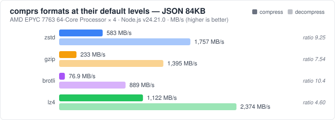
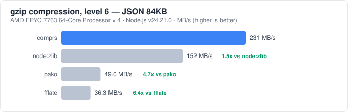

<div align="center">

# comprs

**zstd, brotli, gzip and LZ4 for JavaScript, with one API.**<br />
Native Rust code in Node.js, Deno and Bun; WebAssembly in the browser.

[](https://www.npmjs.com/package/@derodero24/comprs)
[](https://www.npmjs.com/package/@derodero24/comprs)
[](https://github.com/derodero24/comprs/actions/workflows/ci.yml)
[](https://codecov.io/gh/derodero24/comprs)
[](https://codspeed.io/derodero24/comprs)
[](LICENSE)

**[Documentation](https://derodero24.github.io/comprs/)** · **[Playground](https://derodero24.github.io/comprs/playground/)** · **[API reference](https://derodero24.github.io/comprs/api/readme/)**

</div>

## Why comprs?

- **Every format you need.** zstd, brotli, gzip, zlib, raw deflate and LZ4, with dictionaries for zstd and brotli. Browsers have no zstd or LZ4 of their own, and Chrome has no brotli in `CompressionStream`.
- **Native on the server.** Node.js, Deno and Bun load a prebuilt Rust addon. Async calls and streams run on the libuv thread pool, so the event loop keeps turning, and zstd can compress on several threads.
- **WebAssembly in the browser.** Bundlers pick the WebAssembly build through the `browser` condition, with the same functions.
- **One API for every format.** `compress()` and `decompress()` take an options object. There is a `CompressionStream` ponyfill for every format, `AbortSignal` support, and an error `code` you can switch on.
- **Safe with untrusted input.** Decompression stops at a size limit (256 MiB by default), rejects truncated data and data after the end of the stream, and checks every argument.
- **Typed and tested.** Strict TypeScript declarations for Node.js and browsers, checked from ES module, CommonJS and bundler projects, and thousands of tests on every platform. No JavaScript dependencies.

## Comparison with alternatives

| Feature | comprs | pako | fflate | node:zlib |
| --- | :---: | :---: | :---: | :---: |
| zstd | ✅ | ❌ | ❌ | ⚠️ Experimental (Node.js 22.15+) |
| gzip / deflate | ✅ | ✅ | ✅ | ✅ |
| brotli | ✅ | ❌ | ❌ | ✅ |
| LZ4 | ✅ | ❌ | ❌ | ❌ |
| Web Streams | ✅ | ❌ | ❌ | ❌ |
| Node.js Transform | ✅ | ❌ | ❌ | ✅ |
| Browsers | ✅ | ✅ | ✅ | ❌ |
| Deno and Bun | ✅ | ✅ | ✅ | ✅ |
| Native performance | ✅ | ❌ | ❌ | ✅ |
| Dictionaries | zstd, brotli | deflate | deflate | deflate; zstd (Node.js 22.19+, 24.6+) |
| JavaScript dependencies | none | none | none | none |

pako uses chunked `Inflate` and `Deflate` classes rather than Web Streams. Deno 2 and Bun implement `node:zlib`. The [migration guides](https://derodero24.github.io/comprs/migration/pako/) map the APIs of pako, fflate, `node:zlib`, brotli-wasm and `@mongodb-js/zstd` to comprs.

## Installation

```bash
npm install @derodero24/comprs
```

comprs needs Node.js 22 or newer. The package manager installs the native binary for your platform as an optional dependency, and bundlers for browsers pick the WebAssembly build (see [Browsers](https://derodero24.github.io/comprs/guides/browsers/)).

## Quick start

The unified API of `@derodero24/comprs/next` takes the format as an option and returns a `Uint8Array`:

```typescript
import { compress, compressSync, decompress, decompressSync } from '@derodero24/comprs/next';

const data = new TextEncoder().encode('Hello, comprs!');

// On the libuv thread pool in Node.js, Deno and Bun
const zstd = await compress(data, { format: 'zstd', level: 19 });
const restored = await decompress(zstd); // detects the format

// On the calling thread, with a limit for untrusted input
const gzip = compressSync(data, { format: 'gzip' });
decompressSync(gzip, { format: 'gzip', maxOutputSize: 1024 * 1024 });
```

Streams work like the standard `CompressionStream` and `DecompressionStream`, in every format:

```typescript
import { CompressionStream, DecompressionStream } from '@derodero24/comprs/next';

const file = new Blob(['Hello, comprs! '.repeat(1000)]);
const compressed = file.stream().pipeThrough(new CompressionStream('zstd', { level: 9 }));
const restored = compressed.pipeThrough(
  new DecompressionStream('auto', { maxOutputSize: 10 * 1024 * 1024 }),
);
console.log(await new Response(restored).text());
```

The errors that comprs raises have a stable `code`, such as `ERR_COMPRS_SIZE_LIMIT` or `ERR_COMPRS_TRUNCATED` (see [Errors and limits](https://derodero24.github.io/comprs/reference/errors-and-limits/)).

The package root, `@derodero24/comprs`, has a function for each format instead, such as `zstdCompress(data, level)` and `gzipDecompressAsync(data)`, which return a Node.js `Buffer` in the native addon, along with stream contexts and Node.js `Transform` streams (see [Classic API](https://derodero24.github.io/comprs/reference/classic-api/)). Both APIs are supported and write the same bytes at the same settings.

## Documentation

The [website](https://derodero24.github.io/comprs/) has the full documentation:

- [Getting started](https://derodero24.github.io/comprs/getting-started/) and [Choosing an algorithm](https://derodero24.github.io/comprs/choosing-an-algorithm/)
- Guides: [Unified API](https://derodero24.github.io/comprs/guides/unified-api/), [Streaming](https://derodero24.github.io/comprs/guides/streaming/), [Dictionaries](https://derodero24.github.io/comprs/guides/dictionaries/), [Browsers](https://derodero24.github.io/comprs/guides/browsers/), [Servers](https://derodero24.github.io/comprs/guides/servers/)
- Migration from [pako](https://derodero24.github.io/comprs/migration/pako/), [fflate](https://derodero24.github.io/comprs/migration/fflate/), [node:zlib](https://derodero24.github.io/comprs/migration/node-zlib/), [brotli-wasm](https://derodero24.github.io/comprs/migration/brotli-wasm/) and [@mongodb-js/zstd](https://derodero24.github.io/comprs/migration/mongodb-zstd/)
- Reference: [Classic API](https://derodero24.github.io/comprs/reference/classic-api/), [Errors and limits](https://derodero24.github.io/comprs/reference/errors-and-limits/), [Memory](https://derodero24.github.io/comprs/reference/memory/), [Platforms](https://derodero24.github.io/comprs/reference/platforms/), [Benchmarks](https://derodero24.github.io/comprs/reference/benchmarks/), and the [API reference](https://derodero24.github.io/comprs/api/readme/) of every declaration

## Platforms

| Runtime | Backend |
| --- | --- |
| Node.js 22 or newer | Native addon (napi-rs) |
| Deno | Native addon, with `--allow-ffi` and a local `node_modules` |
| Bun | Native addon |
| Browsers | WebAssembly (wasm-bindgen) |

Prebuilt binaries cover macOS (x64, ARM64), Linux (x64, ARM64, with glibc 2.17 or newer, or musl) and Windows (x64, ARM64). [Platforms](https://derodero24.github.io/comprs/reference/platforms/) has the details, the size of the WebAssembly build, and what happens on other platforms.

## Benchmarks





Measured on x86-64 Linux with Node.js 24, with every library at the same settings: comprs decompresses zstd 1.4–3.6 times and gzip 1.0–2.0 times as fast as `node:zlib`, and gzip 3.5–16 times as fast as pako. Its brotli comes from libbrotli, the C library of `node:zlib`, and runs at the same speed. The [Benchmarks page](https://derodero24.github.io/comprs/reference/benchmarks/) of the website has the takeaways and the tables, with compression ratios, by library, format, direction and input. Run the benchmarks locally with `pnpm run bench`; numbers vary by machine and data. [CodSpeed](https://codspeed.io/derodero24/comprs) tracks the Rust benchmarks of `comprs-core` on the pull requests that change Rust code, to catch performance regressions.

## Ecosystem

### [`@derodero24/comprs-middleware`](packages/middleware/)

HTTP compression middleware for Express, Fastify, and Hono.

```bash
npm install @derodero24/comprs @derodero24/comprs-middleware
```

```ts
// Express
import { comprs } from '@derodero24/comprs-middleware/express';
app.use(comprs());

// Fastify
import { comprs } from '@derodero24/comprs-middleware/fastify';
app.register(comprs);

// Hono
import { comprs } from '@derodero24/comprs-middleware/hono';
app.use(comprs());
```

See the [middleware README](packages/middleware/README.md) for every option, and [Servers](https://derodero24.github.io/comprs/guides/servers/) for decompressing request bodies.

## Contributing

See [CONTRIBUTING.md](CONTRIBUTING.md) for development setup and guidelines.

## Security

See [SECURITY.md](SECURITY.md) for vulnerability reporting.

## License

[MIT](LICENSE)

The npm packages also include `THIRD_PARTY_LICENSES`, with the licenses of the Rust crates and of the zstd C library that the native addon and the WebAssembly build link statically.
